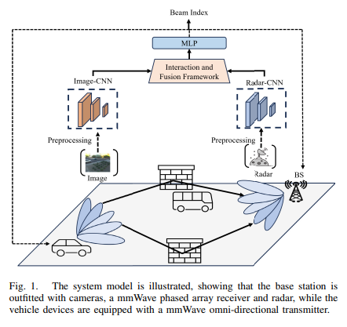
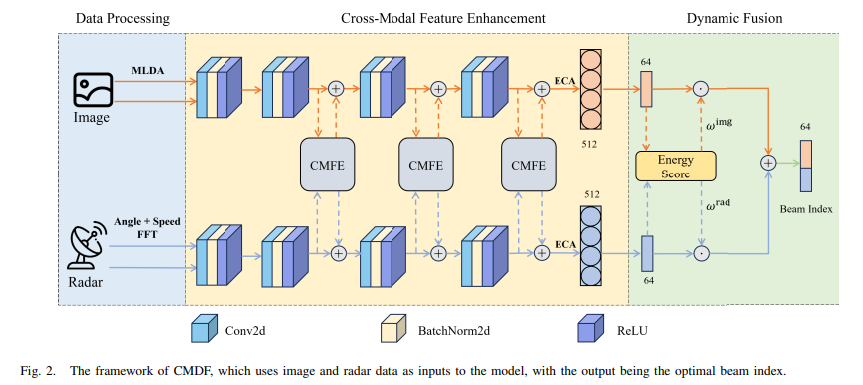
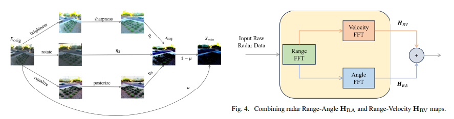
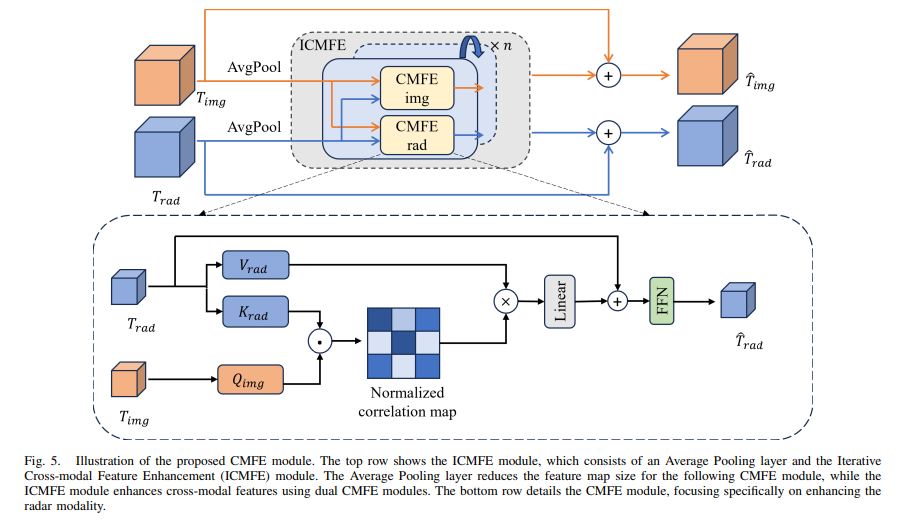
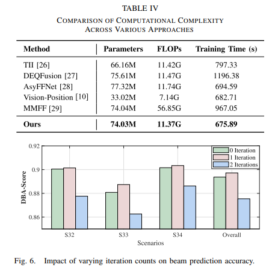
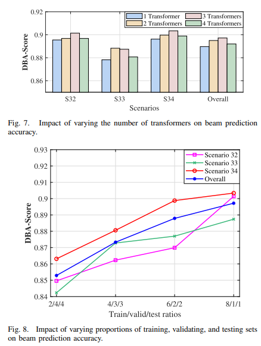

# Build a radar signal processing simulation platform from scratch - Teach you step by step how to understand the "brain" of radar works [with python code]

Building a Radar Signal Processing Simulation Platform from Scratch - Hands-On Tutorial on How to Understand the "Brain" of Radar Works | Radar Simulation | Signal Processing | Deep Learning | Open Source Project
But have you ever thought that the real strength of radar is not the antenna that turns around and around, but the entire set of precision signal processing system inside.
The antenna is just the "eyes" of radar, while the signal processing system is its "brain".
Today's article will take you into a radar signal processing simulation platform, Radar-Sim, which is built from scratch. This project implements the entire process of radar transmitting electromagnetic waves and detecting targets using pure Python, and it also comes with a large number of visualization teaching modules, making it very suitable for students who want to systematically understand radar principles.
More importantly, this project is not only a teaching tool but also possesses the capability to generate effective simulation data. Its ultimate goal is to train machine learning models, making radar detection smarter. This has tremendous potential in fields such as autonomous driving, drone detection, and military reconnaissance.
Next, we will dissect this project from its principles to its applications step by step.
1. How does radar "see" its targets? - Starting with electromagnetic waves. 1.1 Transmission: The simplest principle of radar is actually similar to bat echolocation.
You will shout, and the sound wave travels through the air. When it hits a wall, it bounces back, and your ears receive the echo. Based on the delay time and intensity of the echo, you can roughly estimate the distance to the wall and its material.
The radar does the same thing - it just calls out electromagnetic waves instead of sound waves.
The radar transmitter generates a powerful electromagnetic pulse, which carries energy and propagates at the speed of light (300,000 kilometers per second) in space. When it encounters a target, a portion of its energy is reflected back, creating a return echo.
The key question arises: How can we precisely measure distance and speed?
1.2 Range measurement: Time is the distance traveled by an electromagnetic wave, which takes τ (read as "Tao"). The formula for calculating the distance R is very simple:
R = c × τ / 2 where c is the speed of light. Why divide by two? Because the electromagnetic wave travels in a "round-trip" — from the transmitter to the target, then back to the radar, so the single-way distance is only half of the total distance.
If you launch a short pulse and precisely measure its return time to the receiver, you can calculate the distance to the target.
However, there's a tricky issue: how can you distinguish between two targets with a difference in range?
This leads to an important concept in radar: range resolution.
1.3 Range resolution: The shorter the pulse, the sharper it is. Imagine shining a flashlight at something. If the beam is wide, you can't distinguish between two objects that are close together; if the beam is narrow, you can clearly see them.
The same applies to radar. Range resolution ΔR determines how close two targets can be distinguished:
ΔR = c / (2B) where B is the bandwidth of the signal. A wider bandwidth means higher resolution.
But the problem arises again — sending a very short pulse (high bandwidth) is straightforward, but it carries too little total energy, leading to weak echoes that are overwhelmed by noise.
How can this contradiction be resolved?
II. Pulse Compression - One of the most brilliant designs in radar history
2.1 Long pulse + special modulation = strong and clear
Radar engineers came up with a brilliant idea:
We send a long pulse (carrying a lot of energy), but within this pulse, we let the frequency vary linearly over time — this is the famous **Linear Frequency Modulation (LFM)** technique.
During the transmission pulse, the frequency continuously increases from f0 to f0 + B. By stretching it sufficiently long, T, multiplying it by the bandwidth B, we get a large product T×B (time-bandwidth product).
Then, the receiver uses a technique called "matched filtering" to compress such long pulses into a very narrow peak. The width of the compressed pulse is approximately \(1/B\), similar to the effect of using short pulses—but with much greater energy!
This is the core idea behind pulse compression: using long pulses to achieve high energy and frequency modulation to achieve high resolution.
2.2 T×B Magnetic Force Radar-Sim demonstrates a typical parameter configuration:
Pulse width: 10 microseconds
Signal bandwidth: 50 megahertz
T×B = 500
What does this mean?
A 1 microsecond short pulse can resolve about 3 meters of distance, but with little energy. However, a 10 microsecond LFM pulse after compression can also resolve about 3 meters of distance while having ten times the energy of the short pulse.
Converted into signal-to-noise ratio gain, T×B=500 means that the signal-to-noise ratio has improved by about 27 decibels—a significant difference in practical applications, potentially from "not being able to see the target clearly" to "clearly visible."
The visualization module in the project is very intuitively demonstrating this phenomenon: pulse compression comparison charts under different T×B values, allowing you to immediately see the differences in gain.
III. Antennas — Not Just "Hats" Simple
3.1 Pattern: Electromagnetic waves also have "shapes" Many people think antennas are emitting equally from all directions — like a light bulb shining everywhere equally bright.
However, in reality, radar antennas emit electromagnetic waves with directionality. They act like a spotlight, focusing energy in one direction. This "concentration of light" is the antenna's gain.
More importantly, the strength of the pattern at different angles is different. The main lobe has the highest gain, while sidelobes leak energy, which may cause interference.
Radar-Sim's visualization module specifically demonstrates concepts such as the pattern, sidelobes, and grating lobes, clearly presenting them with two-dimensional and polar coordinate graphs.
3.2 Phased Array - No Need to Turn the Antenna - Scanning Traditional Radar Requires Mechanical Rotation of the Antenna to Scan in Different Directions. This is like needing to turn your head to see different directions.
However, phased array radars do not need to rotate - they "scan" beams in different directions by electronically controlling the phase of each element. This is a thousand times faster than mechanical rotation.
The principle is as follows:
Multiple antenna elements arranged in a line (this is known as an Uniform Linear Array, ULA). If each element transmits the same signal, the beam will point directly forward. However, if we apply different phase shifts to each element, it's like placing different "time delayers" in front of each element, and interference from the waves causes the beam to deviate.
Absolutely, isn't it?
The project details show the variation of beam width when N=4, 8, 16, 32 elements are used, as well as the beam directional pattern at four pointing angles: 0°, 15°, 30°, and 45°.
3.3 Grid lobes - Traps to be avoided in array design when the element spacing is too large (exceeding half a wavelength), resulting in "false main lobes" - grid lobes in the directional pattern.
A slot means that the antenna has a high gain in the direction you do not want, which causes severe angle ambiguity. Therefore, in array design, the element spacing is usually taken as half of the wavelength to avoid the generation of slots.
This is also why the elements of a radar antenna array are often packed closely together.
4. Doppler Effect - The Secret Weapon for Speed Measurement
This is Doppler effect. Radar also uses this principle to measure speed.
When the target approaches the radar, the frequency of the reflected electromagnetic wave will increase (Doppler shift upwards); when the target moves away from the radar, the frequency will decrease (Doppler shift downwards).
The change in frequency (Doppler frequency f_d) is proportional to the radial velocity v of the target.
4.2 MTD——Motion Target Detection
In practice, radars do not simply transmit a single pulse; instead, they continuously transmit multiple pulses within a "Phase-Coherent Processing Interval (CPI)" for example, 64 pulses.
By performing a Fourier transform (FFT) on the echoes from 64 pulses in a distance unit, Doppler frequencies can be separated. This is similar to splitting white light into its spectrum through a prism—different moving targets will appear at different Doppler frequencies.
The resulting two-dimensional plot, called the Range-Doppler Map (RDM), has the horizontal axis representing distance and the vertical axis representing velocity. Each bright spot represents a detected target.
The visualization module in the project brilliantly demonstrates this entire process: from transmitting waveforms, receiving echoes (including noise), pulse compression, to the final RDM and detection results, with each step accompanied by clear charts.
5.2 CFAR — The Radar's "Adaptive Brain"
Why does a fixed threshold fail? Detecting a target seems simple: if the signal exceeds a certain threshold, it is considered detected. However, the problem lies in the intensity of noise and clutter changing—it might be strong near urban areas and weak over the ocean. Using a fixed threshold either leads to missed detection or false alarms.
A radar needs an adaptive threshold that adjusts automatically based on the surrounding environment.
5.2 The Magic of the Sliding Window CFAR (Constant False Alarm Rate Detection) was specifically designed to solve this problem. Its approach is very clever:
For the current detected distance unit (called CUT, Cell Under Test), several regions around it are selected as "training units," where the noise power is estimated, and an adaptive threshold is then calculated.
The key detail is that neighboring units close to the CUT are not included in the noise estimation—these are referred to as "guard cells," preventing target energy from leaking into the noise estimation and overwhelming it.
When environmental noise increases, the threshold automatically rises; when noise decreases, the threshold automatically falls. This ensures that regardless of the environment changing, the false alarm rate remains constant.
This is akin to radar learning "adaptive" - adjusting the alert threshold in noisy areas and lowering standards in quiet ones. It's an elegant design.
The project uses a large-scale diagram to illustrate the working principle of CA-CFAR, including the sliding window structure, training units, protection units, and adaptive threshold curves.
6. The goal is to be "alive" - how do targets move? In real life, targets are not stationary; they have various movement patterns:
Constant Velocity (CV): The simplest form of linear motion, with constant speed
Accelerated Velocity (CA): With a constant acceleration, flying faster or slower
Coordinated Turning (CT): Turning at a constant rate horizontally, which is the most common maneuver for aircraft
The target model in Radar-Sim can simulate these three movements, generating complete 3D trajectories. You can query the position and velocity of the target at any moment, thereby calculating its radial distance and radial velocity relative to the radar.
6.2 Why does RCS change? RCS (Radar Cross Section) measures how "easily a target can be seen by a radar." However, the RCS of the same target may be completely different at different angles and times.
This is because RCS is not solely determined by the size of the target but also depends on its shape, material, and the angle from which the electromagnetic wave "illuminates" it.
In radar engineering, the Swerling model is used to describe the statistical fluctuation characteristics of RCS:
Swerling I: RCS remains constant within a single scan, but changes between scans (slow fluctuation)
Swerling II: RCS fluctuates continuously between pulses (fast fluctuation)
Swerling 0: An idealized non-fluctuating RCS, convenient for theoretical analysis
Swerling III/IV: Used to describe targets with some "stability," with less fluctuation than I/II
This detail is very important for simulations—since real ML training data needs to contain diversity in RCS fluctuations for the model to learn robust features.
7. Frontier Extension - STAP and MIMO 7.1 STAP: The "De-Noising Earbuds" of the Radar World If you've flown, you might have noticed that radars on airplanes don't operate in isolation—ground clutter significantly interferes with the detection of low-altitude targets.
STAP (Space-Time Adaptive Processing) is a game-changing technology for this problem. Its core idea is to jointly utilize information from both the spatial domain (antenna elements) and the temporal domain (multiple pulses), adaptively "cancelling out" clutter.
Simply put: clutter comes from the ground, forming a "clutter spine" on the azimuth-Doppler plane. STAP suppresses the energy on the spine while maintaining the gain towards the target direction, effectively "drilling a hole" through the clutter to transmit target signals.
The project demonstrated the application of MVDR beamformer (Minimum Variance Uncorrelated Subspace) in the space-time domain, comparing the clutter suppression effects of MTI and STAP.
7.2 MIMO: "Sculpting" a Larger Virtual Aperture with Less Antennas MIMO (Multiple Input Multiple Output) radar borrows ideas from communication, using combinations of multiple transmitters and receivers to create virtual arrays several times larger than the actual number.
For example, with 4 transmitters + 8 receivers = up to 32 positions of virtual elements.
This is equivalent to achieving angle resolution comparable to large arrays with a smaller physical volume. This is revolutionary technology for platforms like vehicle radars that are limited by space.
The project detailed the generation principle of MIMO virtual elements, comparison of SIMO vs MIMO directional patterns, and calculation of the expansion of the virtual aperture.
8.1 Use Case for Teaching Radar-Sim provides a bridge from theory to intuitive understanding for students and practitioners in radar-related fields.
The traditional textbooks may be obscure and difficult to understand, but a LFM time-frequency plot, a pulse compression before and after comparison chart, and a CFAR detection example chart can instantly help beginners grasp the core concepts.
The project provides 19 teaching images covering four major areas: antennas, waveforms, signal chain, and key concepts, making it convenient to generate one-click.
8.2 The long-standing issue in machine learning research in the field of radar simulation data is the lack of high-quality labeled data.
Real radar data is restricted by confidentiality requirements and cannot be publicly used. However, Radar-Sim can generate simulated data with true labels from scratch—where the target is located, its speed, and its RCS, all of which are precisely known, essentially perfect annotations.
The simulator supports batch generation in multiple scenarios, supporting different target numbers, distance ranges, RCS distributions, and motion models. This provides an ideal data source for training radar detection models.
8.3 There is a high cost of testing real hardware with new radar signal processing algorithms.
Radar-Sim provides a standardized simulation environment, allowing you to quickly verify the performance of new algorithms. The project includes a complete verification framework (all 81 verifications passed), ensuring the reliability of the simulation results.
From signal chain to STAP to MIMO, almost all mainstream radar processing technologies can be verified on this platform.
Overall, I believe there are several outstanding highlights of the project:
1. Systematic: Covering from physical parameters to emission waveforms, from target echoes to pulse compression, from MTD to CFAR, covering the entire radar signal processing link. It's not a collection of scattered tutorials, but an organic whole.
2. Visually strong: 19 carefully designed schematic diagrams covering antennas, waveforms, signal chain, and key concepts. Each diagram is accompanied by clear textual annotations, very suitable for teaching.
3. Solid theoretical foundation: The target model covers three motion modes (CV/CA/CT) and five RCS fluctuation models (Swerling 0-IV), with high simulation fidelity.
4. Extensibility: The scene assembler supports random multi-target generation and batch simulation, facilitating integration with ML training pipelines.
5. Verification is rigorous: 81 theoretical vs simulation verifications pass, with each item having a clear error tolerance.
The ultimate goal of this project is very clear: to train machine learning radar detection algorithms with simulation data. This represents an important direction in the development of radar technology - a shift from "artificial design" to "data-driven" paradigm.
Perhaps in the near future, radars will be "driven" by neural networks, possessing far greater perceptual capabilities than humans in adverse weather conditions and strong interference environments. This zero-build simulation platform is a crucial foundation towards this future.
This article is based on the open-source project Radar-Sim, which uses Python and NumPy to build. The project architecture is clear and the documentation is complete, making it very suitable for beginners in radar learning and algorithm research.
Recommended reading order:
Step 1 → Generating 19 instructional images to establish intuitive understanding.

## Images

<!-- PAYMENT_BLOCK -->

## Get this dataset

- Payment link (Stripe): [Buy now](https://buy.stripe.com/3cs8yP7sY87d0vu9AB)
- Payment QR code: 

<!-- /PAYMENT_BLOCK -->
